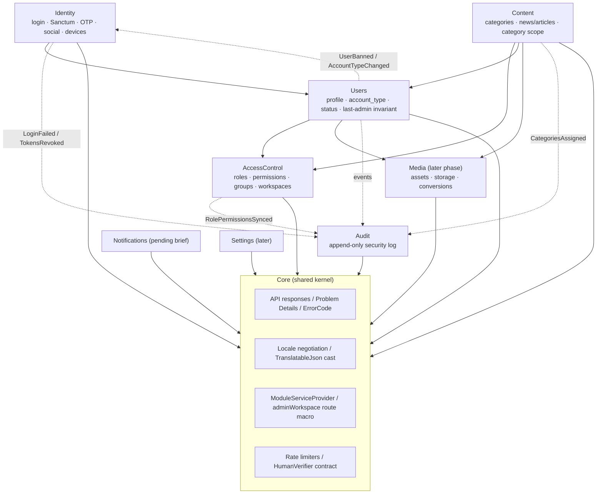

# B. Module map and C. Proposed directory structure

These are proposals; see [ADR-0001](../adr/0001-modular-monolith.md) and [ADR-0012](../adr/0012-administrative-workspaces.md).

## B. Module map

Arrows mean "depends on (calls the public contracts of)". Dashed arrows are domain events.



### Workspaces (admin areas) and the modules behind them

| Workspace key | Admin endpoints served by modules | Permission groups |
|---|---|---|
| `users` | Users, AccessControl | `users`, `roles`, `permissions` |
| `content` | Content | `categories`, `news` |
| `media` | Media | `media` |
| `notifications` | Notifications (pending) | `notifications` |
| `settings` | Settings | `settings` |
| `audit` | Audit | `audit` |

## C. Proposed directory structure (`api/src`)

```
api/src/
├── app/
│   ├── Modules/
│   │   ├── Core/
│   │   │   ├── CoreServiceProvider.php
│   │   │   ├── Support/ModuleServiceProvider.php     # base: migrations, lang, routes, permissions, workspace
│   │   │   ├── Http/Middleware/SetLocaleFromRequest.php
│   │   │   ├── Http/Problems/ (ProblemRenderer, ErrorCode enum, DomainException)
│   │   │   ├── Casts/TranslatableJson.php
│   │   │   ├── Contracts/HumanVerifier.php
│   │   │   ├── Routing/AdminWorkspaceMacro.php
│   │   │   ├── Lang/{ar,en}/errors.php
│   │   │   └── Tests/
│   │   ├── Identity/
│   │   │   ├── Actions/ (LoginWithPassword, IssueToken, RevokeAllCredentials, SendOtp, VerifyOtp, LinkSocialIdentity)
│   │   │   ├── Contracts/OtpSender.php
│   │   │   ├── Http/{Controllers,Requests,Resources,Middleware}/  # EnsureAccountIsUsable, EnsureAdminClient
│   │   │   ├── Models/ (OtpChallenge, UserIdentity)
│   │   │   ├── Listeners/RevokeCredentialsOnStatusChange.php
│   │   │   ├── Database/Migrations/   # personal_access_tokens (published), otp_challenges, user_identities
│   │   │   ├── Routes/api.php  Lang/{ar,en}/  Tests/
│   │   ├── Users/
│   │   │   ├── Actions/ (UpdateProfile, ChangeAccountType, BanUser, DeactivateUser, CreateAdminFromCli)
│   │   │   ├── Enums/AccountType.php  Permissions.php  Workspace.php
│   │   │   ├── Models/User.php        # App\Models\User moves here, or stays and is aliased (decided in phase 1)
│   │   │   ├── Console/CreateAdminCommand.php
│   │   │   ├── Http/…  Policies/UserPolicy.php  Events/  Database/  Routes/  Lang/  Tests/
│   │   ├── AccessControl/
│   │   │   ├── Models/ (Permission, Role extending Spatie; PermissionGroup; Workspace)
│   │   │   ├── Registry/PermissionCatalog.php
│   │   │   ├── Console/SyncPermissionsCommand.php
│   │   │   ├── Http/Middleware/EnsureWorkspaceAccess.php
│   │   │   ├── Database/Migrations/   # spatie tables (published), metadata columns, permission_groups, workspaces
│   │   │   └── …
│   │   ├── Content/
│   │   │   ├── Contracts/CategoryScope.php
│   │   │   ├── Models/ (Category, News)  Policies/  Actions/  …
│   │   │   └── Database/Migrations/   # categories, category_closure?, news, category_user
│   │   ├── Media/        (later phase)
│   │   ├── Audit/
│   │   │   ├── Models/AuditLog.php (append-only)  Listeners/  Http/  Database/  Tests/
│   │   └── Notifications/ (pending brief)
│   ├── Http/Controllers/Controller.php   # existing base controller, kept
│   └── Providers/AppServiceProvider.php  # existing
├── bootstrap/providers.php               # explicit, ordered module provider list
├── config/  (permission.php, sanctum.php published in phase 1; app.php gains supported_locales)
├── lang/{ar,en}/                          # published framework files (validation, auth, passwords)
├── database/                              # existing skeleton migrations remain
└── tests/                                 # cross-module + architecture tests
```

Notes:

- `phpunit.xml` gains test suites pointing at `app/Modules/*/Tests`.
- Moving `App\Models\User` into the Users module is optional. The config references (`auth.providers.users.model`) change if it moves.
- Nothing in this structure exists yet.
