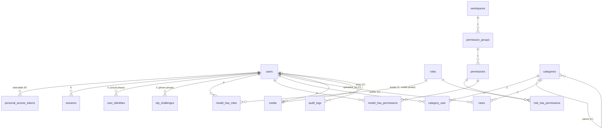

# D. Logical data model

Legend: **E** = exists today · **P** = package table (published by a package) · **C** = proposed custom table/columns · **O** = optional/future.

Nothing here has been migrated. The column types are logical and MySQL 8.4-oriented.

## Tables

| Table | Kind | Owner module | Key columns and constraints | Delete behavior |
|---|---|---|---|---|
| `users` | **E**, extended with **C** columns | Users | see below | Soft delete (C) |
| `password_reset_tokens` | E | Identity | `email` PK | Expire after 60 min |
| `sessions` | E | Identity | `user_id` index | Deleted on logout, ban, or deactivation |
| `cache`, `cache_locks`, `jobs`, `job_batches`, `failed_jobs` | E | Laravel | — | — |
| `personal_access_tokens` | P (Sanctum) | Identity | `token` unique (SHA-256), `tokenable_*`, `abilities`, `expires_at`, `last_used_at` | Deleted on revoke; pruned when expired |
| `permissions` | P + C columns | AccessControl | `UNIQUE(name, guard_name)`; C: `permission_group_id` FK RESTRICT, `display_name` JSON, `description` JSON, `is_deprecated`, `is_sensitive` | Never hard-deleted by sync |
| `roles` | P + C columns | AccessControl | `UNIQUE(name, guard_name)`; C: `display_name` JSON, `description` JSON, `is_protected`, `scope` (`admin`/`public`) | Hard delete (if not protected), audited |
| `model_has_roles`, `model_has_permissions`, `role_has_permissions` | P | AccessControl | Package PKs | Cascade with role/permission |
| `permission_groups` | C | AccessControl | `key` UNIQUE, `name` JSON, `description` JSON, `workspace_id` FK RESTRICT, `module`, `sort_order` | RESTRICT while it has permissions |
| `workspaces` | C | AccessControl | `key` UNIQUE, `name` JSON, `description` JSON, `icon`, `sort_order`, `is_enabled` | Disable, not delete |
| `user_identities` | C (social phase) | Identity | `UNIQUE(provider, provider_user_id)`, `user_id` FK CASCADE, `provider_email`, `provider_email_verified` | Cascade with user |
| `otp_challenges` | C (phone phase) | Identity | ULID PK, `purpose`, `destination`, `code_hash`, `attempts`, `expires_at`, `consumed_at`; INDEX(`destination`, `created_at`) | Pruned after 24 h |
| `categories` | C (content phase) | Content | `parent_id` self-FK, `name` JSON, `slug` UNIQUE | Soft delete; RESTRICT if it has content |
| `category_closure` | O | Content | PK(`ancestor_id`, `descendant_id`), `depth` | Maintained by the Content actions |
| `category_user` | C | Content | PK(`category_id`, `user_id`), INDEX(`user_id`), `granted_by` FK SET NULL | Cascade with either side |
| `news` (or `articles`; ADR-0004 Q4) | C | Content | `category_id` FK RESTRICT, `author_id` FK SET NULL, `status`, `published_at`, `slug` UNIQUE | Soft delete + restore + force delete |
| `media` | C (media phase) | Media | `uuid` UNIQUE, `disk`, `path`, `mime_type`, `size_bytes`, `checksum_sha256`, `visibility`, `purpose`, `uploaded_by` FK SET NULL, `alt_text` JSON | Soft delete, then purge after the grace period |
| `media_conversions`, `news_media` | O | Media / Content | — | Cascade with media |
| `audit_logs` | C | Audit | INDEX(`occurred_at`), (`actor_id`, `occurred_at`), (`subject_type`, `subject_id`, `occurred_at`), (`event`, `occurred_at`) | Append-only; retention job only |
| Notification tables | Pending | Notifications | Waiting on the full update brief (Laravel's built-in `notifications` table is a likely candidate) | — |

## `users` columns (target)

| Column | State | Type | Null | Unique / index |
|---|---|---|---|---|
| `id` | E | BIGINT UNSIGNED | no | PK |
| `name` | E | VARCHAR(255) | no | — |
| `username` | C | VARCHAR(30) | no (after backfill) | UNIQUE |
| `email` | E | VARCHAR(255) | no | UNIQUE (case-insensitive by collation) |
| `email_verified_at` | E | TIMESTAMP | yes | — |
| `password` | E | VARCHAR(255) | **becomes nullable** for social- or phone-only accounts (Q: allow passwordless accounts?) | — |
| `remember_token` | E | VARCHAR(100) | yes | — |
| `phone` | C | VARCHAR(16), E.164 | yes | UNIQUE |
| `phone_verified_at` | C | TIMESTAMP | yes | — |
| `bio` | C | TEXT | yes | — |
| `avatar_media_id` | C (media phase) | BIGINT UNSIGNED | yes | FK `media` SET NULL |
| `social_links` | C | JSON | yes | — |
| `preferred_locale` | C | VARCHAR(8) | yes | — |
| `account_type` | C | VARCHAR(16), default `user` | no | INDEX |
| `deactivated_at`, `deactivated_by` | C | TIMESTAMP, FK | yes | — |
| `banned_at`, `banned_until`, `banned_by`, `ban_reason` | C | TIMESTAMP, TIMESTAMP, FK, TEXT | yes | — |
| `created_at`, `updated_at` | E | TIMESTAMP | yes | — |
| `deleted_at` | C | TIMESTAMP | yes | — |

"Who changed what" lives in `audit_logs`, rather than in `created_by`/`updated_by` columns on `users`.

## Migration ordering (proposal)

1. Users: additive columns (`username` nullable → backfill → NOT NULL + UNIQUE).
2. Identity: Sanctum `personal_access_tokens`.
3. AccessControl:
   - the Spatie tables
   - `workspaces`
   - `permission_groups`
   - the metadata columns on `permissions` and `roles`
   - then the `access:sync-permissions` deploy step
4. Audit: `audit_logs`.
5. Content: `categories`, closure, `news`, `category_user`.
6. Media: `media`, then `users.avatar_media_id`, then the content media FKs.
7. Phone and social phases: `otp_challenges`, `user_identities`.
