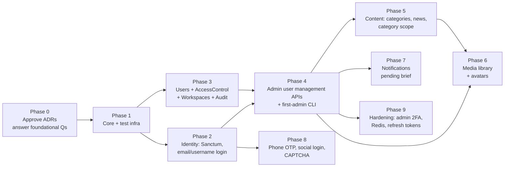

# H. Decision register, I. Implementation roadmap, J. Open questions

## H. Decision register

### Foundational (approve before any implementation)

| # | Decision | ADR |
|---|---|---|
| F1 | Modular monolith, with `app/Modules/*` and explicit provider registration | 0001 |
| F2 | `account_type` enum column (admin, writer, user); no `is_writer` (none exists); status through `deactivated_at`/`banned_at` | 0002 |
| F3 | Admin gate chain; no super-admin bypass; `system-owner` protected role; last-admin invariant; CLI-only first-admin creation and recovery | 0002 |
| F4 | Sanctum: SPA cookie session for the React admin, per-device tokens for mobile, abilities only for client binding; a single guard | 0003 |
| F5 | Email + username login rules (normalization, disjoint formats, uniform errors) | 0003 |
| F6 | Spatie Permission v8, `web` guard, no wildcard, no teams; stable `BackedEnum` identifiers; extended models with `{ar,en}` metadata; `permission_groups`; code-defined catalog + sync command; grant ceiling | 0004 |
| F7 | Workspaces as access permissions (`workspaces.<key>.access`) and route groups `/admin/{workspace}` | 0012 |
| F8 | Response contract: **Problem Details** vs **envelope** (needs a choice); error-code catalog; `/api/v1` with additive-only changes | 0006 |
| F9 | `Accept-Language` negotiation; `lang/{ar,en}`; JSON metadata with a Core cast; key-parity checks | 0007 |
| F10 | Profile fields on `users`; `social_links` JSON with a platform allow-list | 0008 |
| F11 | Custom append-only `audit_logs` written in-transaction; named rate limiters | 0009 |
| F12 | OpenAPI via Scramble, committed `openapi.json`, contract tests | 0010 |
| F13 | MySQL-backed CI suites; dependency policy; raise the PHP floor to `^8.5`; branch protection | 0011 |

### Deferrable (until the relevant module or phase)

| # | Decision | ADR |
|---|---|---|
| D1 | Category hierarchy model (closure table vs path), multi-category news, writer scoping | 0005 |
| D2 | Media library schema details, storage/CDN provider, image extension | 0008 |
| D3 | Phone OTP provider, countries, sign-up-by-phone | 0003 |
| D4 | Social providers (Apple package), sign-up-by-social | 0003 |
| D5 | CAPTCHA provider and the mobile attestation approach | 0009 |
| D6 | Zod and TypeScript generator choice (when React joins) | 0010 |
| D7 | Settings module design | — |
| D8 | **Notification Center**: waiting on the full update brief | (0013, pending) |

### Optional future improvements

- Refresh-token rotation for mobile.
- Mandatory admin 2FA (TOTP) / Fortify.
- `user_bans` history table.
- Translation tables if there are more than about 5 languages.
- Redis for cache, sessions, and queues.
- Larastan.
- Deptrac.
- Pest.
- Audit partitioning.
- `oasdiff` breaking-change checks.
- Idempotency keys.

## I. Implementation roadmap (plan only; each phase needs explicit approval)

| Phase | Scope | Depends on | Infrastructure changes |
|---|---|---|---|
| 0 | Owner reviews the ADRs; answers F8 and the open questions marked *before phase 1* | — | — |
| 1 | Core module (Problem renderer, error codes, locale middleware, `TranslatableJson`, module base provider, route macros, rate limiters); `lang/{ar,en}`; PHP floor `^8.5`; MySQL CI; architecture tests; Scramble | 0 | CI workflow changes |
| 2 | Identity: Sanctum install, SPA + token login, logout, devices, password reset, email verification, status middleware | 1 | CORS/session env per environment |
| 3 | Users columns; AccessControl (Spatie v8, metadata, groups, Workspaces, sync command); Audit | 1 | — |
| 4 | Admin user-management and role APIs; `users:create-admin`; last-admin invariant | 2, 3 | Scheduler container (token pruning) |
| 5 | Content: categories, news, `category_user`, `CategoryScope`, writer endpoints | 4 | Queue worker (exports) |
| 6 | Media: `media` table, upload, conversions, avatars, signed URLs | 4 (5 for news media) | `gd` extension, S3/CDN, queue worker |
| 7 | Notification Center | 4 + full brief | Possibly a push provider (FCM/APNs) and a mail provider |
| 8 | Phone OTP, social login, CAPTCHA | 2 | SMS provider, OAuth apps, CAPTCHA keys |
| 9 | Admin 2FA, Redis, refresh tokens (optional), audit partitioning | 4 | Redis service |

## J. Open questions for the product owner

Grouped by when an answer is needed. Each has a recommended default.

### Needed before phase 1

| # | Question | Impact | Recommended default |
|---|---|---|---|
| J1 | **Problem Details (RFC 9457) or the `{success, message, data, error}` envelope?** (ADR-0006 Q1) | Every endpoint and client parser | Problem Details |
| J2 | **Default locale when no header is sent: Arabic or English?** (ADR-0007 Q1) | Messages for headerless clients | Arabic, if the audience is mainly Arabic-speaking |
| J3 | **Production domains for the API, the admin SPA, and the website** (ADR-0003 Q1) | Cookie session vs. token fallback for React | Same registrable domain |
| J4 | **Raise `composer.json` PHP to `^8.5`?** (ADR-0011 Q1) | Package eligibility | Yes |
| J5 | **Please send the full update brief.** The Workspace and **Notification Center** sections after §6.2 were cut off. | ADR-0012 confirmation, ADR-0013 | — |
| J6 | Definitive launch Workspace list (ADR-0012 Q1) | Admin navigation, permissions | users, content, media, notifications, settings, audit |
| J7 | Can an Admin also be a Writer? (ADR-0002 Q1) | Classification model | No; use separate accounts |

### Needed before phase 3–4

| # | Question | Recommended default |
|---|---|---|
| J8 | Starter roles for launch (ADR-0004 Q3) | `content-manager`, `user-manager`, `auditor` (+ `system-owner`) |
| J9 | `roles.manage` single permission, or split? (ADR-0004 Q5) | Split |
| J10 | Writer self-registration, or promotion by an admin only? (ADR-0002 Q2) | Promotion only |
| J11 | Token lifetimes: admin mobile / public mobile; admin web absolute session (ADR-0003 Q2–Q3) | 30 d / 90 d; 12 h |
| J12 | Unverified-email login allowed? (ADR-0003 Q4) | Yes, restricted |
| J13 | User deletion: soft + anonymize on force-delete? (ADR-0008 Q1) | Yes |
| J14 | Audit retention and legal jurisdiction (ADR-0009 Q1) | 24 months |
| J15 | Admin 2FA mandatory? (ADR-0003 Q7) | Yes, in phase 9 |

### Needed before the relevant phase

| # | Question | Phase |
|---|---|---|
| J16 | News vs. articles: one or two content types? Multi-category? Nested categories? Writers scoped to categories? (ADR-0004 Q4, ADR-0005 Q1–Q4) | 5 |
| J17 | Is article content bilingual per article? (ADR-0007 Q2) | 5 |
| J18 | Central media reuse required? Object storage / CDN provider? (ADR-0008 Q2–Q3) | 6 |
| J19 | SMS/OTP provider, supported countries, budget; sign-up by phone or social? (ADR-0003 Q5–Q6) | 8 |
| J20 | CAPTCHA provider (ADR-0009 Q4) | 8 |
| J21 | Are the React and mobile apps in this repo or separate? (ADR-0010 Q1) | 1 (affects contract sharing) |
